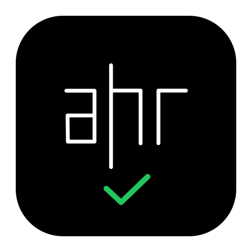

# AHR Assurance

<p align="center">
  
</p>

**Know what your code does, in words everyone can read.** AHR Assurance by AHR Consulting turns the .NET tests you already have into business-readable scenarios, with evidence and an offline HTML report for every run.

- **Code first.** Scenarios are C# in your test project, beside the code they check. No feature files to keep in step with the tests, no step bindings, no new language.
- **Your test suite, as it is.** Keep your framework, runner, assertions and CI: xUnit v2 or v3, NUnit 3.14 to 5, MSTest 3 or 4, or TUnit. Wrap one test at a time; the rest keep running.
- **Nothing new to learn.** A scenario names the steps a test already has. If you can write the test, you can write the scenario.
- **Reports people outside the team can read.** Each run leaves a report that leads with what passed and what needs attention, linked to the outcomes, rules and risks the tests cover.
- **Migrate with an AI agent.** The [AHR Assurance skill](#use-the-ai-skill) converts existing tests to scenarios for you.

<!-- snippet: first-scenario -->
```csharp
[Fact]
public Task ASavedDocumentOpensOfflineAsAScenario()
{
    Document expected = new("handbook", "Offline-ready field handbook");
    FakeDocumentSource source = new(expected);
    FakeInMemoryDocumentCache cache = new();
    DocumentReader reader = new(new FakeOfflineConnectivity(), source, cache);
    DocumentReadResult? result = null;

    return Scenario.Define("A returning offline reader opens a saved handbook")
        .Given("An offline reader with a saved document", () => cache.Seed(expected))
        .When("The reader opens the handbook", async token => result = await reader.OpenAsync("handbook", token))
        .Then("The saved document is returned", () => Assert.Equal(expected, result?.Document))
        .And("The web source is not contacted", () => Assert.Equal(0, source.DownloadCalls))
        .VerifyAsync();
}
```

`dotnet test` runs it as before, and `dotnet assurance report` builds the HTML report from the run. [The report of this repository's own tests](https://ahrconsulting.github.io/assurance/report/), which are written as scenarios, is published with the docs.

## Quick start

Install the CLI as a local .NET tool:

```bash
dotnet tool install Ahr.Assurance.Cli --version 0.1.0
```

Set up each test project, in its folder or once in the solution's folder:

```bash
dotnet assurance init --framework xunit-v3
```

`init` writes `ahr-assurance.json` and adds the adapter at the CLI's version. For the other frameworks, use `xunit-v2`, `nunit`, `mstest` (MSTest 4), `mstest-v3` or `tunit`. For browser tests, add `playwright` beside any of them, such as `--framework xunit-v3,playwright`: you write Playwright as usual, and the report gets a screenshot of each step.

Run the tests, then build the report:

```bash
dotnet test
dotnet assurance report
```

To add an adapter by hand instead, reference its package, then run `dotnet assurance init` without `--framework`:

```bash
dotnet add package Ahr.Assurance.Xunit.v3 --version 0.1.0
dotnet assurance init
```

The other adapters are `Ahr.Assurance.Xunit.v2`, `Ahr.Assurance.NUnit`, `Ahr.Assurance.MSTest`, `Ahr.Assurance.MSTest.v3` and `Ahr.Assurance.TUnit`, and `Ahr.Assurance.Playwright` goes beside any of them. The libraries need .NET 10 or later. Before 1.0, the evidence format and the API can change between versions.

For more, see [Getting started](https://ahrconsulting.github.io/assurance/docs/getting-started/) and [the CLI](https://ahrconsulting.github.io/assurance/docs/cli/).

### Use the AI skill

Optionally, give your AI agent the AHR Assurance skill, so it can write scenarios and convert existing tests. In Claude Code:

```text
/plugin marketplace add AHRConsulting/agent-skills
/plugin install ahr-assurance@ahr-consulting
```

For GitHub Copilot and other agents, copy `plugins/ahr-assurance/skills/ahr-assurance` from [AHRConsulting/agent-skills](https://github.com/AHRConsulting/agent-skills).

## Documentation

The docs are at [ahrconsulting.github.io/assurance](https://ahrconsulting.github.io/assurance/). To start with a topic:

- [Getting started](https://ahrconsulting.github.io/assurance/docs/getting-started/)
- [Scenarios](https://ahrconsulting.github.io/assurance/docs/scenarios/)
- [Business context](https://ahrconsulting.github.io/assurance/docs/business-context/)
- [Evidence](https://ahrconsulting.github.io/assurance/docs/evidence/)
- [The CLI](https://ahrconsulting.github.io/assurance/docs/cli/)
- [Running in CI](https://ahrconsulting.github.io/assurance/docs/ci/)
- [Adapters](https://ahrconsulting.github.io/assurance/docs/adapters/)
- [Analyzers](https://ahrconsulting.github.io/assurance/docs/analyzers/)

## Contributing

See [CONTRIBUTING.md](CONTRIBUTING.md).

## License

Apache-2.0. See [LICENSE](LICENSE) and [NOTICE](NOTICE).
